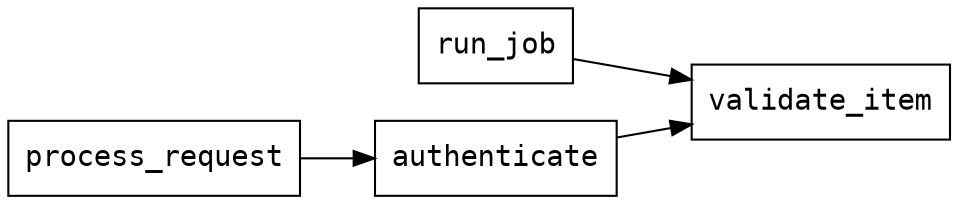

# Calls Adapter Guide (calls://)

**Adapter**: `calls://`
**Purpose**: Cross-file call graph queries — find callers of any function across your entire project
**Type**: Analysis adapter (project-level index)
**Output Formats**: text, json, dot (Graphviz)

## Table of Contents

1. [Quick Start](#quick-start)
2. [URI Syntax](#uri-syntax)
3. [How It Works](#how-it-works)
4. [Query Parameters](#query-parameters)
5. [Output Formats](#output-formats)
6. [Workflows](#workflows)
7. [Call Graph in ast://](#call-graph-in-ast)
8. [Limitations](#limitations)
9. [Performance & Caching](#performance-caching)
10. [FAQ](#faq)
11. [Related Documentation](#related-documentation)

---

## Quick Start

```bash
# Who calls validate_item anywhere in the project? (reverse lookup)
reveal 'calls://src/?target=validate_item'

# What does validate_item call? (forward lookup)
reveal 'calls://src/?callees=validate_item'

# Include callers-of-callers (2 levels deep)
reveal 'calls://src/?target=validate_item&depth=2'

# Graphviz dot output (pipe to dot for SVG/PNG)
reveal 'calls://src/?target=main&format=dot' | dot -Tsvg > call_graph.svg

# Within-file call graph (ast:// adapter — cheaper, no project index)
reveal 'ast://src/auth.py?show=calls'

# Find all callers of a function in a single file (within-file only)
reveal 'ast://src/auth.py?calls=validate_token'
```

**Why use calls://?**
- **Impact analysis**: Before changing a function, find all callers across the codebase
- **Understand behaviour**: Find what a function calls to trace its dependencies
- **Trace execution paths**: Follow call chains to understand how a feature triggers
- **Dead code detection**: A function with no callers may be unused
- **Visualize architecture**: Export call graphs to Graphviz for documentation

---

## URI Syntax

```
# Reverse lookup: who calls function X?
calls://<path>?target=<name>[&depth=N][&format=<fmt>]

# Shorthand (colon syntax): same as ?target=
calls://<path>:<name>

# Forward lookup: what does function X call?
calls://<path>?callees=<name>[&format=<fmt>]

# Ranking: most-called functions in the project
calls://<path>?rank=callers[&top=N]
```

| Component | Description |
|-----------|-------------|
| `path` | Directory (or file) to index — typically `src/` or `.` |
| `target` | Function name to find **callers of** (reverse lookup) |
| `callees` | Function name to find **callees of** (forward lookup) |
| `rank` | Set to `callers` to rank all functions by in-degree (coupling metrics) |
| `top` | Max results for `?rank=callers` (default: 10; `0` = all) |
| `depth` | Transitive levels for `?target` (default: 1, max: 5) |
| `format` | Output format: `text` (default), `json`, or `dot` (Graphviz) |

### Colon Shorthand

The colon syntax `calls://path:name` is equivalent to `calls://path?target=name`. Reveal detects that the portion before the colon is an existing filesystem path and the portion after is a bare name (no slashes), and automatically routes it as `?target=`:

```bash
# These are equivalent:
reveal 'calls://src/auth.py:validate_token'
reveal 'calls://src/?target=validate_token'

# Works with directories too:
reveal 'calls://src:validate_token'
reveal 'calls://src/?target=validate_token'
```

### Examples

```bash
# Direct callers of process_batch (reverse lookup)
reveal 'calls://src/?target=process_batch'

# What does process_batch call? (forward lookup)
reveal 'calls://src/?callees=process_batch'

# Callers-of-callers (2 levels)
reveal 'calls://src/?target=process_batch&depth=2'

# Full transitive tree (5 levels max)
reveal 'calls://src/?target=entry_point&depth=5'

# Graphviz for visual diagram
reveal 'calls://src/?target=main&format=dot' | dot -Tsvg > main_callers.svg

# JSON for programmatic use
reveal 'calls://src/?target=validate_item&format=json'

# Whole-project index (use . for current dir)
reveal 'calls://.?target=my_function'
```

---

## How It Works

JSX component uses are typed source references, not runtime invocation proof.
`<Button/>`, paired tags and namespace components contribute records marked
`relationship: jsx_reference`, with `reference_lines`; an expression that is also
called has `call_and_jsx_reference`. Intrinsic tags and template strings contribute
no component edge. Named render functions and `memo`/`forwardRef` function values
retain their existing owners, including named function expressions whose inner
name differs from the wrapped variable, `memo(fn, areEqual)` with a comparator,
`React.memo`, `memo(forwardRef(fn))` and `Object.assign(wrapper(fn), {...})`. Any other
call with exactly one function-literal argument (`withFallback("X", fn)`) also names that
function after the variable; a callback passed to an array method (`xs.map(x => <B/>)`)
is not a component, so its references belong to the function that runs the `map`. The nearest tracked function owns nested
callback references, and an unnamed callback (`it`, `describe`, `beforeEach`, hooks)
belongs to the smallest tracked element that contains it, as call sites do; a deferred
body with no tracked element around it is marked
`<anonymous>` and excluded from module callers. Only references outside deferred
bodies belong to `<module>`. Class-field initializer references keep class
source ownership but are outside caller navigation; render methods remain indexed. Imported aliases are resolved through the shared
name-resolution seam. Callees and trace use the same references; callees text labels a name that is only rendered
`(JSX reference)` and a name that is both called and rendered `(includes JSX reference)`. Callers text
names each kind of site: `[call line 3, JSX line 4]` (JSON: `call_lines` and `reference_lines`), `[JSX line 6]`,
and `[lines 5, 6]` for a name that is only called more than once. `--sideeffects --transitive` follows a
render-only reference as a hop (rendering a child runs it) and labels it `(JSX render)`; the `chain` of
the JSON findings ends in `<Child/>`. Dynamic render scheduling, Angular/HTML strings and Vue/Svelte
navigation remain outside this relationship model. Known limit: a scope is identified by its name and line, so two same-named functions
on one line (minified or generated code) are one scope and share each other's JSX references. The existing conservative
`uncalled` suppression remains separate from caller attribution.

The `calls://` adapter builds a **project-level callers index** from all code files under the given path:

1. **Collect structures** — runs the same analysis as `ast://` on every code file in the directory
2. **Build inverted index** — maps each callee name → list of (file, function, line) caller records
3. **Cache by mtime** — the index is cached per directory; any file change triggers a rebuild
4. **BFS traversal** — for `depth > 1`, performs a breadth-first walk up to `depth` levels of callers

```
callee → [(file, caller_func, line), ...]
```

**Callee normalisation**: `self.foo` is normalised to `foo` for lookup. The original call expression (`self.foo`) is preserved in the `call_expr` field of each result record.

---

## Query Parameters

| Parameter | Type | Default | Description |
|-----------|------|---------|-------------|
| `target` | string | — | Function name to find **callers of** (reverse lookup) |
| `callees` | string | — | Function name to find **callees of** (forward lookup) |
| `rank` | string | — | Set to `callers` to rank all functions by in-degree |
| `uncalled` | flag | — | List dead-code candidates — functions/methods with no static callers (see [Workflow 2](#workflow-2-find-unused-functions-dead-code)) |
| `top` | integer | 10 for `?rank`, all for `?uncalled` | Max results for `?rank=callers` or `?uncalled`; `0` = all. `--limit N` becomes `top=N` |
| `depth` | integer | 1 (`?root`: 2) | Transitive levels for `?target` and `?root` (1 = direct only, max 5) |
| `builtins` | boolean | `false` | Include Python builtins in output (applies to `?callees` and `?rank=callers`) |
| `format` | string | `text` | Output format: `text`, `json`, or `dot` |
| `root` | string | — | Root function name for a recursive callee-tree traversal. Each definition is walked on its own; a callee name that several definitions share, with none in the caller's file or imports, is listed as `ambiguous` with its candidates and not expanded |
| `modules` | boolean | `false` | Build a module-level dependency graph instead of function-level |
| `external` | boolean | `false` | Include external (non-project) modules in the `?modules` graph |
| `test-framework` | boolean | `false` | Include test-framework entrypoints as callers in `?rank=callers` |

> One of `target`, `callees`, `rank`, `uncalled`, `root`, or `modules` is required. If `rank=callers` is given, it takes precedence.

### `target`

Reverse lookup — who calls this function? The bare function name, no file qualifier needed:

```bash
# Bare name (most common)
reveal 'calls://src/?target=validate_item'

# Method names work the same way
reveal 'calls://src/?target=process'
```

### `callees`

Forward lookup — what does this function call? Scans all definitions of the function name across the project:

```bash
# What does validate_item call? (builtins hidden by default)
reveal 'calls://src/?callees=validate_item'

# Include Python builtins (len, str, sorted, ValueError, open, eval, etc.)
reveal 'calls://src/?callees=validate_item&builtins=true'

# Useful when a function is defined in multiple files
reveal 'calls://src/?callees=handle_request'
```

Python builtins (`len`, `str`, `sorted`, `ValueError`, `open`, `print`, etc.) are hidden by default — they add noise without revealing project structure. Use `?builtins=true` when you specifically want to audit dangerous builtins like `eval`, `exec`, or `open`.

> `?builtins` applies to both `?callees` (forward lookup) and `?rank=callers`. The `?target` (reverse lookup) is unaffected — callers of builtins are always shown.

### `rank`

Rank all callable symbols in the project by how many unique callers they have (in-degree coupling metric). Zero new infrastructure — uses the same cached index as `?target`.

```bash
# Top 10 most-called functions
reveal 'calls://src/?rank=callers'

# Top 20, include builtins
reveal 'calls://src/?rank=callers&top=20&builtins=true'
```

Output:

```
Most-called functions: src/
Ranking by:            caller count (in-degree)
Showing:               10 of 87 unique callees

  validate_item  (5 callers)
    utils/auth.py:42  check_token
    api/routes.py:18  post_handler
    api/routes.py:31  put_handler
    workers/batch.py:9  run_job
    workers/batch.py:55  process_item

  parse_config  (3 callers)
    …
```

High in-degree = potential coupling hotspot. Functions at the top are load-bearing — changes ripple wide.

### `depth`

Expands callers transitively. Level 1 = direct callers, level 2 = callers of those callers, etc.:

```bash
reveal 'calls://src/?target=validate_item&depth=1'   # default — direct callers
reveal 'calls://src/?target=validate_item&depth=2'   # direct + their callers
reveal 'calls://src/?target=validate_item&depth=5'   # up to 5 levels deep (capped)
```

---

## Output Formats

### Text (default)

Human-readable summary with relative file path, line, and caller context:

```
Callers of: validate_item
Project:    src/
Total:      3

  src/auth/handlers.py:42  authenticate  (calls validate_item)
  src/api/routes.py:78     process_request  (calls validate_item)
  src/worker/jobs.py:17    run_job  (calls self.validate_item)
```

> File paths are relative to the project root — not just the basename — so `auth/handlers.py` and `utils/handlers.py` are never confused.

With `depth=2`:

```
Callers of: validate_item
Project:    src/
Depth:      2
Total:      5

Direct callers:
  src/auth/handlers.py:42  authenticate  (calls validate_item)
  src/worker/jobs.py:17    run_job  (calls self.validate_item)

Level 2 callers:
  src/api/routes.py:78  process_request  (calls authenticate)
  src/main.py:12        main  (calls run_job)
```

When no callers are found:

```
Callers of: orphan_fn
Project:    src/
Total:      0

  No callers found for 'orphan_fn'.
```

If `.gitignore` (or `--exclude`/REVEAL_IGNORE) hid every file under the path, the zero is
not the code's: the output adds `⚠ No files left to analyze: N entries hidden by .gitignore
(use --no-gitignore to show)`, and JSON carries a `scope_hidden` entry in `meta.warnings`
with `count`, `hidden` (per cause) and `suggestion`.

**Callees text output** (`?callees=`):

```
Callees of: validate_item
Project:    src/
Total:      4 call(s) across 1 definition(s)

  src/auth/validators.py:55  validate_item
    → check_required
    → normalize_value
    → log_validation
    → raise_error

            (6 builtin(s) hidden — use ?builtins=true to include)
```

With `?builtins=true` the footer disappears and the full raw list (including `len`, `str`, `isinstance`, etc.) is shown. The footer only appears when at least one builtin was filtered.

When the function is not found:

```
Callees of: unknown_fn
Project:    src/
Total:      0 call(s) across 0 definition(s)

  No definition of 'unknown_fn' found.
```

### JSON

Structured data for programmatic processing:

```bash
reveal 'calls://src/?target=validate_item' --format=json
```

```json
{
  "contract_version": "1.1",
  "type": "calls_query",
  "source": "src/",
  "target": "validate_item",
  "depth": 1,
  "total_callers": 3,
  "levels": [
    {
      "level": 1,
      "callers": [
        {
          "file": "src/auth.py",
          "caller": "authenticate",
          "line": 42,
          "call_expr": "validate_item",
          "callee": "validate_item"
        },
        {
          "file": "src/worker.py",
          "caller": "run_job",
          "line": 17,
          "call_expr": "self.validate_item",
          "callee": "validate_item"
        }
      ]
    }
  ]
}
```

### Dot (Graphviz)

Directed graph format for visualisation:

```bash
# Text preview
reveal 'calls://src/?target=validate_item&format=dot'

# SVG
reveal 'calls://src/?target=main&format=dot' | dot -Tsvg > call_graph.svg

# PNG
reveal 'calls://src/?target=main&format=dot' | dot -Tpng > call_graph.png
```

Example dot output:



---

## Workflows

### Workflow 1: Impact Analysis Before Changing a Function

Before modifying a function, understand all callers to assess risk:

```bash
# Step 1: Direct callers
reveal 'calls://src/?target=parse_config'

# Step 2: Expand to understand full impact (transitive)
reveal 'calls://src/?target=parse_config&depth=3'

# Step 3: Extract files to review
reveal 'calls://src/?target=parse_config' --format=json | \
  jq -r '.levels[0].callers[].file' | sort -u
```

### Workflow 2: Find Unused Functions (Dead Code)

```bash
reveal 'calls://src/?uncalled'                # all functions/methods with no callers
reveal 'calls://src/?uncalled&type=function'  # module-level only (skip methods)
reveal 'calls://src/?uncalled&top=20'         # most-recently-modified uncalled first
```

Note: static analysis produces false positives for runtime-dispatched functions (framework entry points, console scripts, dispatch tables). Treat results as candidates to investigate, not definitive dead code.

### Workflow 3: Trace an Execution Path

Starting from an entry point, trace who it calls and what calls it:

```bash
# Who calls the entry point?
reveal 'calls://src/?target=handle_request'

# What does handle_request call? (use ast://)
reveal 'ast://src/?callee_of=handle_request'

# Or see everything handle_request calls
reveal 'ast://src/handler.py?calls=*' --format=json | jq '.results[] | select(.called_by | contains(["handle_request"]))'
```

### Workflow 4: Generate Architecture Documentation

```bash
# Visual call graph for documentation
reveal 'calls://src/?target=main&depth=3&format=dot' | \
  dot -Tsvg -Grankdir=TB > architecture.svg

# JSON for custom visualisation
reveal 'calls://src/?target=main&depth=5' --format=json > call_tree.json
```

### Workflow 5: Verify Refactoring

After extracting a function, confirm the old callers now use the new name:

```bash
# Check old name has no callers
reveal 'calls://src/?target=old_parse_config'

# Check new name has callers
reveal 'calls://src/?target=parse_config'
```

### Workflow 6: Understand What a Function Does (Forward Lookup)

Before reviewing or debugging a function, see what it delegates to:

```bash
# What does process_request call?
reveal 'calls://src/?callees=process_request'

# Useful for understanding a function you've never seen before
reveal 'calls://src/?callees=initialize_app'
```

This is faster than reading the full implementation when you just want to know the collaboration pattern — what it orchestrates, not how.

---

## Call Graph in ast://

For within-file analysis, `ast://` provides lighter-weight call graph features without building a project index:

| Feature | `ast://` | `calls://` |
|---------|---------|-----------|
| Scope | Within a single file | Across the whole project |
| `calls` outgoing | ✅ (via JSON or text renderer) | ✅ `?callees=<name>` (forward lookup) |
| `called_by` incoming | ✅ within-file reverse | ✅ `?target=<name>` (full project) |
| Filters | `calls=<name>`, `callee_of=<name>` | `target=<name>`, `callees=<name>` |
| Display mode | `show=calls` (arrow diagram) | text / json / dot |
| Cross-file resolution | `resolved_calls[]` in JSON | full index |
| Cache | No (per-request) | Yes (mtime-based) |

**Use `ast://` when:**
- You're already inspecting a single file and want to see call structure inline
- You want to filter functions by what they call (`calls=validate*`)
- You want a quick call graph diagram for a file (`show=calls`)

**Use `calls://` when:**
- You need to know all callers across the entire project
- You need transitive call chains (`depth > 1`)
- You want Graphviz output for documentation
- You're doing impact analysis before changing a function

### ast:// call graph examples

```bash
# Show calls/called_by for every function (arrow diagram)
reveal 'ast://src/auth.py?show=calls'

# Find functions calling validate_token
reveal 'ast://src/?calls=validate_token'

# Find functions called by main
reveal 'ast://src/?callee_of=main'

# JSON: get calls + resolved_calls for a specific function
reveal 'ast://src/auth.py?name=authenticate' --format=json | \
  jq '.results[0] | {calls, called_by, resolved_calls}'
```

---

## Limitations

**Known missing inputs.** When a Calls query reports failed file analysis or
directory enumeration, surviving observations remain available with
`meta.parse_mode: tree_sitter_partial` and no numeric `meta.confidence`.
Directory diagnostics count identified directories; the number of missing files
is unknown. Text shows required-loss warnings once, and supported DOT views send
them to stderr to keep stdout a valid graph. These warnings retain Calls' legacy
exit behavior; exit 0 alone does not establish complete analysis. An uncalled
candidate remains a heuristic, not proof of dead code.

The non-Python reference pass for `?uncalled` also discloses actual file-read
failures. Losing callback or function-pointer evidence can make an active
function appear uncalled, so these classifications may be incorrect as well as
incomplete. Diagnostics identify the attempted file even if the OS error omits
its filename. They belong to that query and do not contaminate the healthy
caller index; a later successful read restores the normal result. A single-file
definition query can still require reference evidence from sibling files.

The independent language census used for confidence also reports actual directory
loss, even when a healthy retained query index supplies every observed caller.
Census loss withholds the score instead of silently substituting a default or a
score based on the surviving languages. Partial metadata qualifies the required
census input; it does not establish a parser failure or an identified missing
query row. Clean empty/unmeasured populations retain their normal fallback score.
Other census consumers and non-enumeration stat/configuration failures have
separate limits.

**Static analysis only.** The following patterns are not resolved:

- **Dynamic dispatch** — `getattr(obj, method_name)()`, callback tables, metaclasses
- **Method resolution order (MRO)** — `super().method()` is tracked as `method`, not resolved to a specific parent class
- **Lambdas and closures** — may appear in calls list but context is limited
- **Runtime-generated names** — `importlib.import_module()`, `__import__()`

**Scope is per-directory.** The index is built from `path` downward. Callers above the given path are not visible:

```bash
reveal 'calls://src/?target=fn'   # won't see callers in tests/ above src/
reveal 'calls://.?target=fn'       # use project root for full coverage
```

**Top-level callers:** Python, JS/TS, PHP and Ruby source files include a synthetic
`<module>` caller for calls outside named functions/methods, including script loops
and Ruby DSL blocks. Caller JSON carries `caller_kind: module`, `line` set to the first call line (the first JSX line when
the name is only rendered; `callees=<module>` prints the module's first call line, not 1) and every matching call in `call_lines`. Counts are unique caller scopes;
several sites in one module remain one caller. Deferred function bodies retain
their own scope. Class-body initializers, extensionless Ruby DSL files and other
languages' top-level code remain outside this relationship scope and are disclosed.

```bash
reveal 'calls://src?callees=<module>'
reveal 'trace://src?from=script.py:<module>&depth=2'
```

**`line` in a caller record is the caller function's definition line, not the call-site line.** Each record is built per-*function*, not per-*call-expression* — repeat calls to the same target within one function collapse to a single record, and that record's `line` is where the caller function is `def`ined, not where the call itself appears in the body. Don't use it to jump to the exact call; use it to locate the calling function.

**`called_by` in `ast://` is within-file only.** If a function has callers only in other files, `called_by` will be empty in `ast://` output. The `calls://` adapter is the authoritative source for cross-file callers.

**Language support.** Call extraction relies on tree-sitter analyzers. Python has the best support. JS/TS/Go/Rust work but have shallower call extraction for complex expressions.

**JS/TS: calls inside a nested arrow cascade to every enclosing scope, not just the arrow's own.** A `let`/`const`-bound arrow gets its own element in the calls index, but the calls-computation walk for an *enclosing* function does not stop when it reaches that nested arrow — it only stops at a nested *declared* function/method. So a call made inside a nested arrow is credited to the arrow's own scope **and** every enclosing scope up to (and including) the nearest declared function/method, not just the innermost. For example:

```ts
trigger() {
  const fn = () => { this.doResolve?.(null); }
}
```

`reveal 'calls://.?target=doResolve'` lists both `fn` and `trigger` as callers, since executing `trigger()` does transitively execute that call. This is intentional depth, not a bug — it doesn't cause false negatives — but it means callers counts for functions called from inline closures will be higher than a naive "innermost scope only" model expects. Plain anonymous/inline arrows (callback arguments, object-literal property values) don't get their own element at all and are attributed only to the nearest enclosing named scope, same as a Python `lambda`.

### False Positives in `?uncalled`

`?uncalled` uses static name matching and cannot see runtime dispatch. Common sources of false positives: framework entry points (`@mcp.tool()`, `@app.route()`), console scripts wired in `pyproject.toml`, dispatch table functions (`_RENDERERS = {'key': fn}`), and unsupported top-level/class-body call shapes.

A function used without being called is not listed, in any language: passed as a value, callback or function pointer (C `qsort(..., cmp)`, C++ `&Class::method` in Godot's `ClassDB::bind_method`, Go `wg.Go(l.run)`, Java `X::m`, a JS callback, object-literal value, `export` or JSX `<Button/>`), called outside a function body (module level, a Kotlin `init {}` block, a Scala class body), named in a PHP hook string or callable array (`add_action('init', 'fn')`, `[$this, 'm']`) or a Ruby symbol (`before_action :authenticate`). The rule is by name, like the rest of `calls://`: any other occurrence of the name counts, so an unrelated variable of the same name can hide a dead function (BACK-1391). A function referenced only from a non-code file (Redis's `commands.def` table) is still listed. Constructors are excluded in Java, C#, C++ and Dart (recognized by their declaration: no return type), as are overrides wherever the language marks them (`override` in C#/Kotlin/Swift/C++, including a C++ `override` on the in-class declaration of an out-of-line definition, and `@Override`/`@override` in Java/Dart), framework-registered methods (Spring/JAX-RS/Dagger annotations, ASP.NET `[HttpGet]`/`[Route]`, ASP.NET `Invoke`/`Configure` by name), Swift `init`/`deinit`/operators, C/C++ `main`, operators, destructors and GoogleTest/Catch2 `TEST(...)` bodies, and Godot's GDCLASS hooks (`_bind_methods`, `_notification`, ...) in classes that declare `GDCLASS` (BACK-1392). The exact list for the scanned language is printed with the result. Rust calls inside macro arguments (`format!("{}", h())`) are recovered best-effort from the macro's token tree (BACK-1393).

Add `# noqa: uncalled` to a `def` line to exclude a specific function from results. The suppression is narrow — the function still appears in all other `calls://` queries.

---

## Performance & Caching

The project-level index is cached in memory per process per directory:

- **Cache key**: directory and immediate child-directory modification times, plus
  the active exclusion and gitignore scope. This avoids a full file walk on a
  matching hit; ordinary file overwrites and deeper membership changes can leave
  the key unchanged in a long-lived process.
- **Known missing inputs**: a supplied traversal-incomplete collection bypasses a
  matching callers index and prevents retention. An index in which a file could not
  be read (a denied permission, an I/O error) or was lost to a dead worker is returned
  but not retained either, so the next request reads that file again; a failure the
  file's content causes is retained. Python reference discovery,
  read or parse failures also prevent retaining the reference set, so access or
  source recovery can rebuild it. These guards do not establish general warm-cache
  freshness. The non-Python reference pass runs again per uncalled query and keeps
  its read-loss diagnostics local to that query; it does not evict healthy indexes.
- **Rebuild cost**: depends on the source population and analysis work; use a
  narrower directory when the question permits it.

Serialized MCP requests validate retained callers and Python-reference caches
with the shared path/mtime/size fingerprint, rebuilding changed roots while
preserving unchanged entries. Each distinct retained root incurs a validation
walk, including on unrelated tool requests. These fingerprints are not atomic
snapshots or content/readability guarantees; an edit that preserves size and
mtime can evade them. Direct adapter/helper calls outside the host request
boundary retain the cheap-key behavior described above.

For very large codebases (100K+ lines), point at a subdirectory:

```bash
# Faster — only indexes auth/ module
reveal 'calls://src/auth/?target=validate_token'

# Full project — slower first run, cached after
reveal 'calls://src/?target=validate_token'
```

---

## FAQ

**Q: What if `target` is a common name used in many places?**

A: The index returns all files that call it. Use JSON output and filter by file if needed:

```bash
reveal 'calls://src/?target=process' --format=json | \
  jq '.levels[0].callers[] | select(.file | contains("auth"))'
```

**Q: Can I search for method calls like `obj.method()`?**

A: Yes. The index normalises `self.foo` → `foo` for lookup. Pass the bare method name:

```bash
reveal 'calls://src/?target=validate'   # matches self.validate(), obj.validate(), validate()
```

The `call_expr` field in results preserves the original form (`self.validate_item`).

**Q: The function exists but `total_callers` is 0. Is something wrong?**

A: A few possibilities:
- The function is never called (genuine dead code)
- It's called only from outside the indexed path — try `calls://.?target=fn`
- It's called via dynamic dispatch (not statically resolvable)
- The caller is in a file type not indexed (e.g., `.yaml` or `.sh`)

**Q: How do I find all functions that are never called (dead code)?**

A: Use `?uncalled`:

```bash
reveal 'calls://src/?uncalled'              # all uncalled functions + methods
reveal 'calls://src/?uncalled&type=function' # skip methods
reveal 'calls://src/?uncalled&top=20'       # most-recently-added uncalled first
```

See the Known False Positives section above for patterns that produce false positives, and `# noqa: uncalled` for suppression.

**Q: How do I audit code for dangerous builtins like `eval` or `open`?**

A: Use `?builtins=true` on a `?callees=` query to include builtins in the output, then grep:

```bash
# Find every function that calls eval
reveal 'calls://src/?callees=process_input&builtins=true' | grep 'eval'

# Or scan callers of eval directly (reverse lookup — always includes builtins)
reveal 'calls://src/?target=eval'
```

The `?target=` direction (reverse lookup) always returns results regardless of `?builtins` — builtins filtering only applies to the forward `?callees=` direction.

**Q: Is `calls://` the same as a full call graph tool like pycallgraph or pyCallGraph?**

A: No — `calls://` is a fast static analysis tool built on the same parse trees as `ast://`. It doesn't execute code, doesn't track dynamic dispatch, and doesn't generate flame graphs. For profiling and runtime call graphs, use profiling tools. For structural analysis, refactoring, and impact assessment, `calls://` is faster and doesn't require a running application.

---

## Related Documentation

- [`AST_ADAPTER_GUIDE.md`](AST_ADAPTER_GUIDE.md) — `ast://` adapter, including within-file call graph features (`calls=`, `callee_of=`, `show=calls`)
- [`IMPORTS_ADAPTER_GUIDE.md`](IMPORTS_ADAPTER_GUIDE.md) — import graph analysis (`imports://`)
- [`AGENT_HELP.md`](../AGENT_HELP.md) — complete agent workflow reference including call graph task patterns
